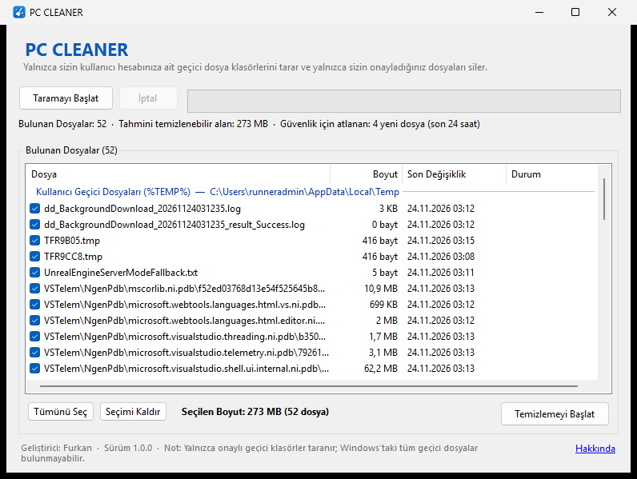

<p align="center">
  
</p>

<h1 align="center">PC CLEANER</h1>

<p align="center">
  Windows 10 / 11 için <b>basit, hızlı ve güvenli</b> geçici dosya temizleyici.<br/>
  Ücretsiz · Reklamsız · Hesap yok · İnternet yok · Veri toplama yok
</p>

<p align="center">
  
  
  
  <a href="../../actions/workflows/ci.yml"></a>
</p>

---

<p align="center"></p>

## ✨ Ne yapar?

1. **Taramayı Başlat** → yalnızca sizin kullanıcı hesabınıza ait geçici klasörleri tarar.
2. Bulunan dosyaları, toplam boyutu ve **Seçilen Boyut** bilgisini gösterir.
3. **Temizlemeyi Başlat** → onay ister, yalnızca **sizin seçtiğiniz** dosyaları siler.
4. Kullanımda olan veya erişilemeyen dosyaları atlar ve size bildirir.

Bu kadar. Kayıt defteri temizliği, RAM “hızlandırma”, sürücü güncelleme gibi özellikler **bilerek yoktur**.

## 📥 İndirme

[**Releases**](../../releases/latest) sayfasından:

| Dosya | Açıklama |
|---|---|
| `PCCleaner_Setup_1.0.0.exe` | Kurulum sihirbazı (yönetici izni gerektirmez, Başlat menüsü + masaüstü kısayolu) |
| `PCCleaner.exe` | Taşınabilir sürüm — kurulum yok, çift tıkla çalıştır |

> .NET kurulu olması **gerekmez**; çalışma zamanı EXE'nin içindedir.
> Uygulama dijital olarak imzalı olmadığı için Windows SmartScreen “Bilinmeyen yayımcı” uyarısı gösterebilir → **Ek bilgi → Yine de çalıştır**.

## 📂 Hangi klasörler taranır?

| Konum | Örnek yol |
|---|---|
| Kullanıcı geçici dosyaları | `%TEMP%` → `C:\Users\<siz>\AppData\Local\Temp` |
| Uygulama çökme dökümleri | `C:\Users\<siz>\AppData\Local\CrashDumps` |

**Asla taranmaz:** Masaüstü, Belgeler, İndirilenler, Resimler, Videolar, tarayıcı profilleri,
sistem geri yükleme verileri, Program Files, Windows klasörü.

> Not: PC CLEANER Windows'taki *tüm* geçici dosyaları bulduğunu iddia etmez; yalnızca yukarıdaki onaylı klasörlere bakar.

## 🛡️ Güvenlik kuralları

- Her dosya silinmeden hemen önce **yeniden doğrulanır**: yol onaylı klasörün *içinde* mi, `..\` ile dışarı çıkıyor mu?
- **Sembolik bağlantılar / junction'lar asla takip edilmez** — klasör dışına işaret eden bir bağlantı üzerinden hiçbir şey silinemez.
- `%TEMP%` yanlışlıkla kullanıcı klasörüne, sürücü köküne veya Windows klasörüne ayarlanmışsa o konum **reddedilir**.
- **Son 24 saatte değişen** dosyalar listelenmez (çalışan bir kurulum hâlâ kullanıyor olabilir).
- Salt okunur ve sistem dosyalarına dokunulmaz; izinler değiştirilmez, zorla silme yapılmaz.
- Başka bir programın açık tuttuğu dosyalar atlanır.
- Yönetici izni **istenmez** (`asInvoker`).
- Silme işlemi her zaman kullanıcı onayı ile başlar; sessiz/otomatik silme yoktur.

## 🧱 Proje yapısı

```
PcCleaner.sln
├─ src/
│  ├─ PcCleaner.Core/      Tarama, yol güvenliği ve silme mantığı (platformdan bağımsız, test edilebilir)
│  │   ├─ TempLocations.cs   Onaylı klasörler
│  │   ├─ PathGuard.cs       Yol doğrulama, traversal ve bağlantı koruması
│  │   ├─ Scanner.cs         Asenkron, iptal edilebilir tarama
│  │   └─ Cleaner.cs         Doğrulamalı, tek tek silme
│  └─ PcCleaner.App/       Windows Forms arayüzü (Türkçe)
├─ tests/PcCleaner.Tests/  xUnit testleri (39 test)
├─ .github/                CI: gerçek Windows'ta derleme, test ve GUI açılış testi
├─ installer/              NSIS kurulum betiği (Setup.exe)
└─ build.ps1               Tek komutla derle + test + paketle
```

## 🔧 Kaynaktan derleme

Gereksinim: [.NET 10 SDK](https://dotnet.microsoft.com/download/dotnet/10.0) · (Setup.exe için isteğe bağlı: [NSIS](https://nsis.sourceforge.io))

```powershell
git clone https://github.com/furkantr1923/pc-cleaner.git
cd pc-cleaner
.\build.ps1
```

Yalnızca çalıştırmak için: `dotnet run --project src/PcCleaner.App`
Yalnızca test: `dotnet test`

## ✅ Testler

Ayrıntılar: [TEST_RAPORU.md](TEST_RAPORU.md)

## 👤 Geliştirici

**Furkan** · [@furkantr1923](https://github.com/furkantr1923)

## 📄 Lisans

[MIT](LICENSE)
